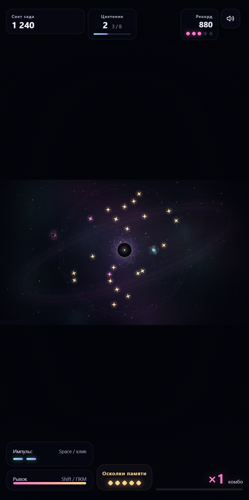

<p align="center">
  
  
  
  
</p>

<h1 align="center">GameHungerG · Starfall Orchard</h1>
<p align="center">Вырасти сад внутри умирающей звезды, пока свет не начал охотиться на тебя.</p>

---

**Starfall Orchard** — атмосферная арена-игра о последнем садовнике звёзд. Собирай осколки памяти, корми сердце звезды и выбирай улучшения на каждом цветении. Пожиратели света ускоряются, комбо множит очки, а импульс и рывок спасают в последний момент.

- **Один файл** — вся игра в `index.html`, без сборки, сервера и интернета.
- **Живая графика** — Canvas 2D, многослойное свечение, частицы, parallax и процедурная графика.
- **Адаптивный звук** — эмбиент и эффекты синтезируются через WebAudio.
- **Прогрессия** — уровни, три случайных улучшения, комбо и локальный рекорд.
- **Управление** — WASD/стрелки или мышь; touch-жесты; `Space` — импульс, `Shift` — рывок, `Esc` — пауза.

## Быстрый старт

Открой `index.html` двойным щелчком. Для проверки без браузера:

```bash
node scripts/check-game.cjs
```

## Скриншот

<p align="center"></p>

## Документация

- [`docs/CONTEXT.md`](docs/CONTEXT.md) — состояние проекта и глоссарий.
- [`docs/DECISIONS.md`](docs/DECISIONS.md) — архитектурные решения.

## Стек

HTML5 · CSS · Vanilla JavaScript · Canvas 2D · WebAudio · localStorage

## Статус

**v1.0** — Полная игровая петля. Проверены синтаксис, логика, прямой `file://`-запуск, клавиатура, мышь, touch-раскладка и адаптив. Стресс-тест рендера: 60 fps при 332 частицах; длительная симуляция: 300 секунд без ошибок.

## Лицензия

[MIT](LICENSE) © Alexander Kuzikov
